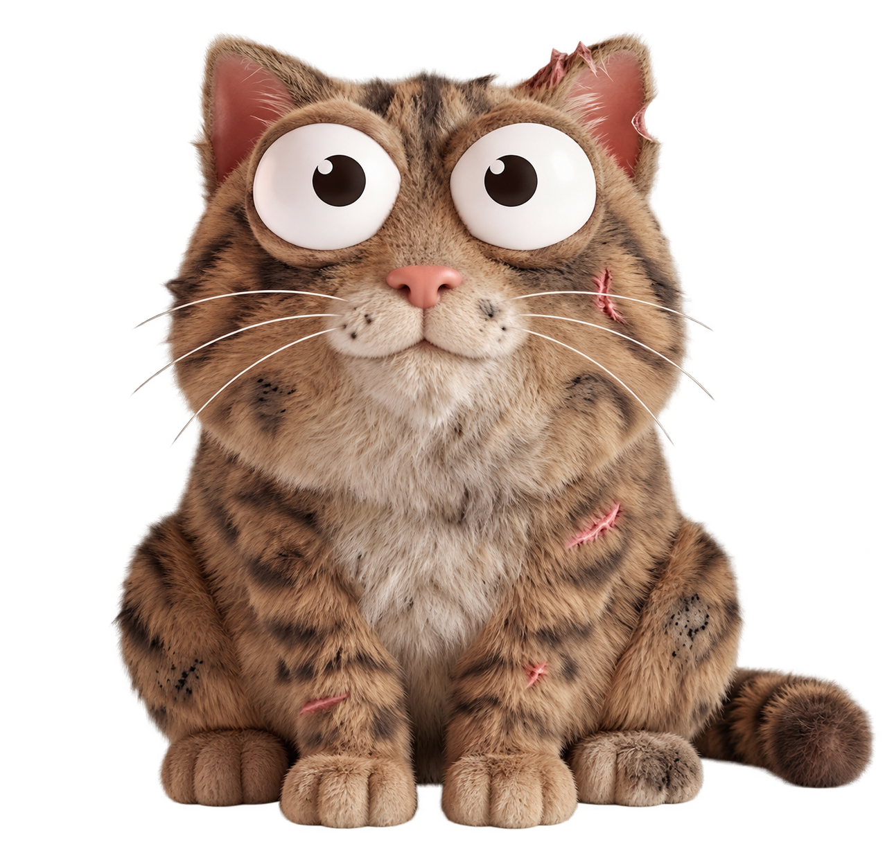
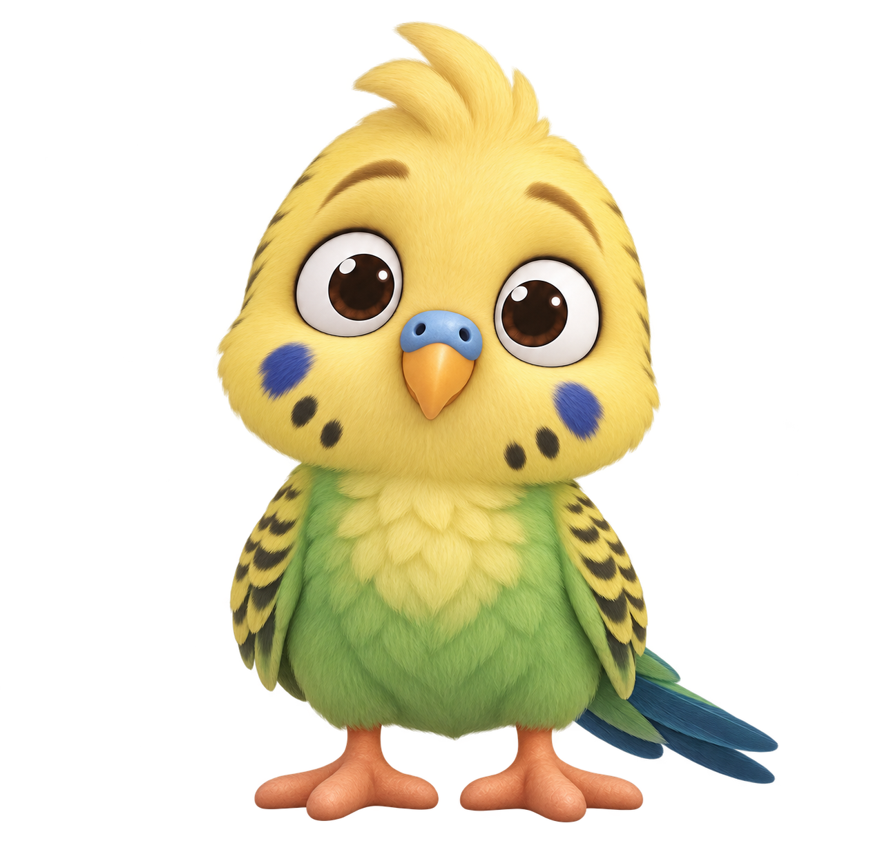

# Pou Game | Sanal Evcil Hayvan

Flutter ve Flame ile geliştirilmiş bir sanal evcil hayvan oyunu. On karakterden birini seç, mutfakta yemeğini hazırla ve mini oyunlarda kazandığın coin’lerle ona bak. Oyunlardan topladığın XP, evcil hayvanının genel seviyesine eklenir.

<p align="center">
  
  
  
</p>

## Odalarda neler var?

| Oda | Yapabileceklerin |
| --- | --- |
| **Home** | Evcil hayvanını okşa, durum göstergelerini kontrol et ve **Games** menüsünden bir mini oyun seç. Level ikonuna dokunarak sonraki seviyeye kalan XP’yi gör. |
| **Kitchen** | **Fridge** içinden coin ile yiyecek satın al. Sol alttaki yiyeceği evcil hayvanının üzerine bıraktığında stoktan bir adet tüketilir ve açlık barı dolar. |
| **Bathroom** | Tuvalet ve temizlik akışını başlat. Seçtiğin karaktere ait kısa video oynatılır. |
| **Bedroom** | Lambaya dokunarak uyut veya uyandır. Uyurken enerji geri kazanılır. |

Odalar arasında oda adının iki yanındaki oklarla geçilir. Mağazadan yeni karakterler alabilir ve sahip oldukların arasında geçiş yapabilirsin.

## Mini oyunlar

- **Tetris:** Blokları kaydır, döndür ve satırları tamamla. Temizlenen her satır **5 coin** kazandırır.
- **Flappy Cube:** Dokunarak küpü havada tut ve engellerin arasından geçir.

Aktif oyun süresi enerji tüketir ve XP kazandırır. Turun sonunda **Collect** ile ödülleri alırsın. Tetris’in hız seviyesi ile evcil hayvanının bakım seviyesi birbirinden bağımsızdır.

**Kayıt durumu:** Coin, stok, sahip olunan karakterler ve XP şu anda oyun oturumu içinde tutulur. Uygulamayı kapatınca ilerleme kaydedilmez.

## Çalıştırma

Dart `^3.9.0` ile uyumlu bir Flutter SDK ve bir Android cihaz veya emülatör gerekir. Önce cihazı başlat, ardından:

```sh
git clone https://github.com/fgencay/pou_game.git
cd pou_game
flutter doctor
flutter pub get
flutter devices
flutter run
```

Birden fazla cihaz bağlıysa `flutter run -d <cihaz-id>` ile hedefi seçebilirsin. Tetris motoru depoya dahil olduğu için ayrıca kurulması gerekmez.

## Geliştirme

| Dizin | İçerik |
| --- | --- |
| `lib/features/` | Karakterler, bakım değerleri, envanter, satın alma ve XP kuralları |
| `lib/game/` | Flame sahnesi, karakter çizimi ve dokunma tepkileri |
| `lib/presentation/` | Karakter seçimi, odalar, mini oyun ekranları ve göstergeler |
| `lib/core/config/` | Asset yolları, ödül değerleri ve level eşikleri |
| `assets/` | Karakter görselleri, oda arka planları, sesler ve videolar |

```sh
flutter analyze
flutter test
flutter test third_party/tetris_engine/test
```

Tetris için kullanılan `tetris_engine` paketinin [MIT lisansı](third_party/tetris_engine/LICENSE) ve [yerel uyarlama notları](third_party/tetris_engine/LOCAL_CHANGES.md) depoda bulunur. Bu lisans yalnızca ilgili üçüncü taraf bileşenine aittir.
